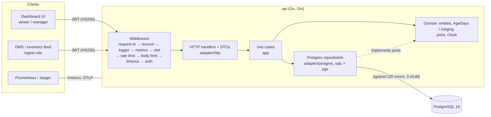
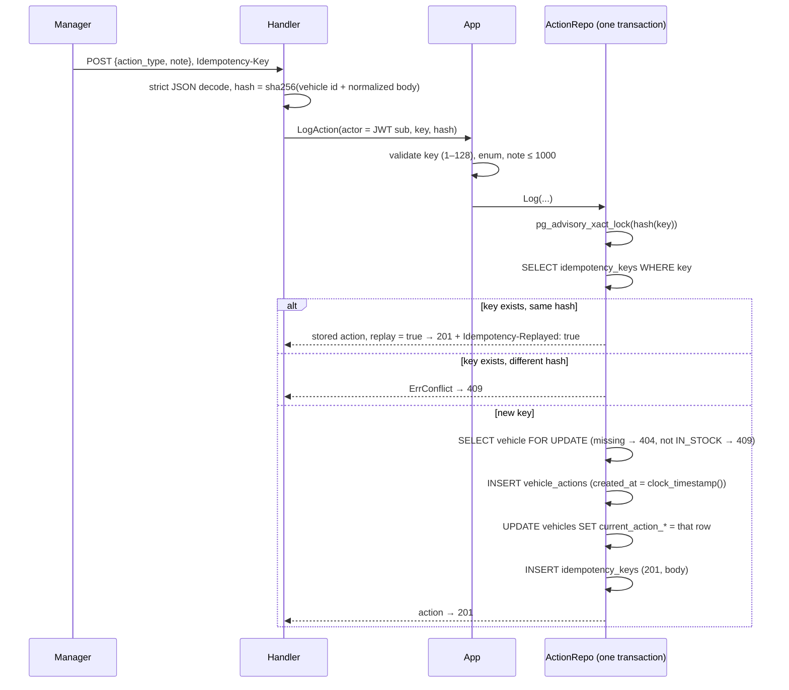
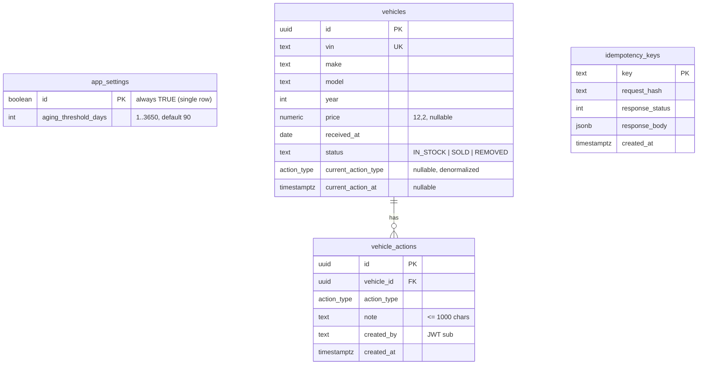

# System Design: Intelligent Inventory Dashboard

**Scope:** the backend (Go + PostgreSQL) for **one dealership**. It covers three needs: a filterable inventory list, identifying aging stock (more than 90 days by default, with a configurable threshold), and logging the actions managers take on vehicles. Multi-dealership support is out of scope. The migration path is in [Future: multi-dealership](#future-multi-dealership).

## 1. Architecture



The layering is hexagonal (ports and adapters):

- **`internal/domain`** holds the entities (`Vehicle`, `VehicleRow`, `Action`, `ActionType`), the rules (`AgeDays`, `IsAging`, `AgingCutoff`), the keyset `Cursor`, the domain errors and the ports (`VehicleRepo`, `ActionRepo`, `SettingsRepo`, `Clock`). It imports no adapter or infrastructure code.
- **`internal/app`** holds the use cases (list, aging, summary, log action, history, settings, ingest). It depends only on the domain ports, and it validates input and turns age filters into date bounds.
- **`internal/adapter/http`** is the driving adapter. It contains the Gin router, middleware, request parsing, DTOs, the error mapping and the role checks.
- **`internal/adapter/postgres`** is the driven adapter. It contains the repositories on sqlc-generated queries (`db/gen`), the transactions and the embedded goose migrations.
- **`internal/platform`** holds the cross-cutting pieces: config, the JSON logger, Prometheus metrics, OpenTelemetry setup and JWT authentication.
- **`cmd/api`** wires everything together. It has three subcommands: `serve` (the default), `migrate` and `token`.

## 2. Component roles

| Component | Role |
|---|---|
| `db` (compose) | PostgreSQL 18, data volume at `/var/lib/postgresql` |
| `migrate` (compose, one-shot) | `api migrate` applies the goose migrations embedded in the binary |
| `seed` (compose, one-shot) | `seed -if-empty` loads about 500 demo vehicles on the first start only, so logged actions survive restarts |
| `api` | Serves HTTP on :8080 and starts after `seed` has completed |
| `jaeger` (optional profile) | OTLP trace sink and UI (`--profile observability`) |
| `Clock` port | Supplies "today". It is `SystemClock` (UTC date) in production and `FixedClock` in tests, so ages are deterministic |

## 3. Data flow

### List and aging (`GET /v1/vehicles`, `GET /v1/vehicles/aging`)

1. Middleware assigns a request id, checks the per-IP rate limit, bounds the body and the request time (5 s), then verifies the JWT and puts the `Principal` in the context. `require(PermRead)` admits viewers and managers.
2. The handler parses the query (`make`, `model`, `min_age_days`, `max_age_days`, `aging`, `cursor`, `limit`). Anything malformed is a 400.
3. The app reads the threshold **once per request**, then turns age into dates with today from the injected clock:
   - `min_age_days=N` becomes `received_before = today − N`.
   - `aging=true` becomes `received_before = today − (threshold + 1)`, so day 90 is excluded and day 91 is included.
   - `max_age_days=M` becomes `received_after = today − M`.
   - When both lower bounds are present, the stricter one wins.
4. The repository runs `ListVehicles` with `LIMIT limit+1` and keyset `(received_at, id) > cursor`, ordered oldest first. The extra row tells it whether a `next_cursor` exists. The cursor is `base64url(JSON {d, id})`.
5. The app computes `age_days` and `is_aging` for each row in Go from the same `today` and threshold. They are never selected from SQL.

### Log action (`POST /v1/vehicles/{id}/actions`)



- **Same key, concurrent requests:** the advisory lock serializes requests that share a key, so exactly one row is written and the others replay it.
- **Different keys on one vehicle:** these serialize on the vehicle row lock. `created_at` uses `clock_timestamp()` (the time after the lock is taken), not `now()` (the time the transaction started). With `now()`, a writer that waited on the lock could get an *earlier* timestamp than the action it waited behind, and `current_action` would then disagree with the newest history row. The race test covers this.
- **Failed requests do not store a key**, because the transaction rolls back. A client can retry a 404 with the same key after fixing the request.
- **Early action is allowed.** Any in-stock vehicle accepts an action, not only aging ones, so managers can act before day 91. Sold or removed vehicles return 409.

### Ingest (`POST /v1/ingest/vehicles`)

1. Only the `ingest` role may call it. The body holds 1 to 1000 vehicles and is strictly decoded.
2. The app validates each row. The VIN must be 17 characters with no I, O or Q (lower-case is uppercased), make and model must be non-empty, the year must be in range, the price must be ≥ 0 with at most 2 decimals, `received_at` must not be in the future, and the status must be valid. Duplicate VINs inside a batch are rejected, with the index in the error message.
3. A single `INSERT … SELECT unnest(...) ON CONFLICT (vin) DO UPDATE … WHERE (columns) IS DISTINCT FROM EXCLUDED` writes the batch and returns `xmax = 0` for each written row. Unchanged rows are skipped, so re-sending a batch gives `{inserted: 0, updated: 0}`. The update list never includes `current_action_*`.
4. `ingest_rows_total{result=inserted|updated|unchanged}` is incremented.

## 4. Technology choices

| Choice | Why |
|---|---|
| **Go 1.27** | Simple concurrency, a single static binary, a strong standard library (`log/slog`, `net/http`), and fast cold start in a distroless image |
| **Gin** | Mature router with route templates (`c.FullPath()`), which give low-cardinality metric labels, plus first-class OpenTelemetry middleware |
| **PostgreSQL 18** | Relational data with real constraints (enum, CHECK, FK, partial indexes), row-value comparison for keyset pagination, and transactional idempotency |
| **pgx v5 + pgxpool** | The fastest Postgres driver for Go, with native types, COPY for seeding, and a tracer hook for OpenTelemetry |
| **sqlc** | Queries are plain SQL that can be reviewed and EXPLAINed. Generated code is type-safe, with no ORM magic and no reflection at runtime |
| **goose (embedded)** | Plain-SQL up/down migrations shipped inside the binary, so one image both migrates and serves |
| **JWT HS256** | Stateless and enough for an MVP with a stubbed identity provider. Moving to RS256/JWKS later changes only `platform/auth.go` |
| **Prometheus + OpenTelemetry** | De-facto standards: pull metrics, OTLP traces that work with any backend, and W3C trace propagation |
| **testcontainers-go** | Integration tests run against the same `postgres:18` image as compose. The database is never mocked, because the interesting behavior (indexes, locks, `ON CONFLICT`, enums) lives there |
| **kin-openapi** | Validates real requests and responses against `api/openapi.yaml`, so the spec cannot drift from the code |

## 5. Data model



Indexes:

- **`idx_vehicles_age (received_at, id) WHERE status = 'IN_STOCK'`** serves every list, aging and keyset query. It is partial, so sold stock costs nothing.
- **`idx_vehicles_mm (make, model) WHERE status = 'IN_STOCK'`** is available to make/model lookups. In practice the planner prefers walking `idx_vehicles_age` in order and filtering (see EXPLAIN case 6), which is cheap while makes are common.
- **`idx_actions_vehicle (vehicle_id, created_at DESC)`** serves the action history.

`current_action_type` and `current_action_at` are denormalized onto `vehicles` so that the list and the summary need no join or `DISTINCT ON` over the history. They are written only by `Log`, in the same transaction as the history row.

UUIDs are generated in the application as **UUIDv7** (time-ordered), which keeps B-tree inserts local.

## 6. Aging design: derive at query time, no cron

Age is `today − received_at` and **is never stored**. A vehicle is aging when `age_days > threshold`.

| | Query-time derivation (chosen) | Nightly cron with a stored flag |
|---|---|---|
| Correctness | Always exact for "today", with no window where a flag is stale | Stale between runs. A missed or failed run leaves wrong data |
| Threshold change | Takes effect on the next request with no backfill | Needs a recompute of every row |
| Moving parts | None | A scheduler, retries, monitoring and locking against ingest |
| Query cost | `received_at <= today − (t+1)` is a range condition on `idx_vehicles_age`: 0.06 ms for the first aging page at 250k rows | Index on the flag; similar |
| Testability | An injected `Clock` makes boundaries (day 90 vs 91) deterministic | Time-dependent jobs are harder to test |

The rules live in one place, `domain.AgeDays`, `domain.IsAging` and `domain.AgingCutoff`. A unit test checks that the SQL cutoff and `IsAging` agree for every age from 0 to 199. Dates are UTC calendar dates.

The one thing a stored flag offers is a "became aging today" event. That is the optional daily job in the [scaling path](#9-scaling-path). It would emit events, not maintain state.

## 7. Observability

- **Logs:** JSON `slog` to stdout, set as the default once in `main`. There is one line per request with `request_id, method, route, status, latency_ms, subject`. `route` is the template (`/v1/vehicles/:id/actions`), never the raw path. Headers and bodies are never logged, so tokens and action notes stay out, and a test asserts both are absent. 5xx responses log at error level along with the underlying error.
- **Request id:** a safe inbound `X-Request-Id` (≤ 128 characters, `[A-Za-z0-9._-]`) is reused, otherwise a UUID is generated. It is echoed on every response and included in every error body.
- **Metrics (`/metrics`):**
  - `http_requests_total{route,method,status}`
  - `http_request_duration_seconds{route}` (histogram, 5 ms to 5 s)
  - `actions_logged_total{action_type}` (replays excluded)
  - `ingest_rows_total{result}`
  - `db_pool_{acquired,idle,total,max}_conns`, `db_pool_acquire_total`, `db_pool_empty_acquire_total`, `db_pool_acquire_duration_seconds_total`
  - Go and process collectors
  - The registry is private, so tests can build routers freely.
- **Tracing:** `otelgin` spans for each request (health and metrics are filtered out), with `otelpgx` child spans for every query, transaction and pool acquire. Query parameters are not recorded. Export is OTLP/gRPC to `OTLP_ENDPOINT`, and nothing is exported when it is unset. W3C `traceparent` propagation is enabled.
- **Suggested alerts:** p95 latency per route, 5xx rate, `db_pool_empty_acquire_total` rate (pool saturation), and 429 rate.
- **Lifecycle:** `/healthz` is liveness and is always 200. `/readyz` pings the database and returns 503 on failure. On SIGTERM the server stops accepting connections and drains in-flight requests (15 s budget), then the pool closes and traces flush.

## 8. Performance and EXPLAIN plans

Measured on 2026-10-30 against `docker compose` on one Linux workstation (22 cores, 15 GB RAM). The setup was one API container with a pool of 20 connections, `postgres:18` with default settings, and k6 running on the same host. The data came from `make seed-load`: 250,000 vehicles (242,577 in stock, 73,001 aging at threshold 90) and 60,359 actions.

### k6: `scripts/k6/list.js` (50 VUs, 1 minute)

The mix is the list with no filter, make + model, a 30-day age window, aging, aging + make, and aging paged 3 cursors deep.

| Metric | Result | Target |
|---|---|---|
| p95 `http_req_duration` | **25.0 ms** | < 100 ms ✓ |
| median / p90 / max | 11.8 ms / 21.3 ms / 119.7 ms | |
| Throughput | 3,740 req/s (224,522 requests) | |
| Failed requests / failed checks | 0.00% / 0.00% | < 1% ✓ |

### EXPLAIN (ANALYZE, BUFFERS) at 250k rows

These plans come from the exact `ListVehicles` sqlc query, prepared with parameters the way pgx sends it, under the pool's `plan_cache_mode = force_custom_plan`. Every list and aging variant uses `idx_vehicles_age`, and none does a sequential scan. Keyset pagination keeps a deep page (case 3) as cheap as the first page.

**1. List, no filters (first page, limit 50)**

```
 Limit  (cost=0.42..5.97 rows=51 width=82) (actual time=0.050..0.366 rows=51.00 loops=1)
   Buffers: shared hit=52
   ->  Index Scan using idx_vehicles_age on vehicles v  (cost=0.42..26390.81 rows=242600 width=82) (actual time=0.049..0.359 rows=51.00 loops=1)
         Index Searches: 1
         Buffers: shared hit=52
 Planning:
   Buffers: shared hit=208
 Planning Time: 0.848 ms
 Execution Time: 0.400 ms
```

**2. Aging (threshold 90 => received_at <= today-91), first page**

```
 Limit  (cost=0.42..13.08 rows=51 width=82) (actual time=0.021..0.047 rows=51.00 loops=1)
   Buffers: shared hit=52
   ->  Index Scan using idx_vehicles_age on vehicles v  (cost=0.42..18349.01 rows=73905 width=82) (actual time=0.021..0.042 rows=51.00 loops=1)
         Index Cond: (received_at <= '2026-07-31'::date)
         Index Searches: 1
         Buffers: shared hit=52
 Planning:
   Buffers: shared hit=12
 Planning Time: 0.195 ms
 Execution Time: 0.061 ms
```

**3. Aging, deep page (cursor after 5000 aging rows)**

```
 Limit  (cost=0.42..26.17 rows=101 width=82) (actual time=0.042..0.685 rows=101.00 loops=1)
   Buffers: shared hit=96
   ->  Index Scan using idx_vehicles_age on vehicles v  (cost=0.42..18450.79 rows=72356 width=82) (actual time=0.041..0.672 rows=101.00 loops=1)
         Index Cond: ((received_at <= '2026-07-31'::date) AND (ROW(received_at, id) > ROW('2026-03-14'::date, '01a18bc6-8ab8-7658-aaea-1f3bdeeea660'::uuid)))
         Index Searches: 1
         Buffers: shared hit=96
 Planning Time: 0.161 ms
 Execution Time: 0.726 ms
```

**4. Age range 120-150 days**

```
 Limit  (cost=0.42..53.82 rows=51 width=82) (actual time=0.049..0.160 rows=51.00 loops=1)
   Buffers: shared hit=49
   ->  Index Scan using idx_vehicles_age on vehicles v  (cost=0.42..15348.78 rows=14658 width=82) (actual time=0.048..0.154 rows=51.00 loops=1)
         Index Cond: ((received_at <= '2026-07-02'::date) AND (received_at >= '2026-06-02'::date))
         Index Searches: 1
         Buffers: shared hit=49
 Planning:
   Buffers: shared hit=3
 Planning Time: 0.149 ms
 Execution Time: 0.174 ms
```

**5. Aging + make**

```
 Limit  (cost=0.42..103.81 rows=51 width=82) (actual time=0.013..2.252 rows=51.00 loops=1)
   Buffers: shared hit=441
   ->  Index Scan using idx_vehicles_age on vehicles v  (cost=0.42..18533.77 rows=9142 width=82) (actual time=0.013..2.243 rows=51.00 loops=1)
         Index Cond: (received_at <= '2026-07-31'::date)
         Filter: (make = 'Toyota'::text)
         Rows Removed by Filter: 408
         Index Searches: 1
         Buffers: shared hit=441
 Planning Time: 0.128 ms
 Execution Time: 2.268 ms
```

**6. make + model (no age filter)**

```
 Limit  (cost=0.42..1530.61 rows=51 width=82) (actual time=0.031..3.308 rows=51.00 loops=1)
   Buffers: shared hit=1553
   ->  Index Scan using idx_vehicles_age on vehicles v  (cost=0.42..27603.81 rows=920 width=82) (actual time=0.030..3.298 rows=51.00 loops=1)
         Filter: ((make = 'Honda'::text) AND (model = 'Civic'::text))
         Rows Removed by Filter: 1570
         Index Searches: 1
         Buffers: shared hit=1553
 Planning Time: 0.145 ms
 Execution Time: 3.344 ms
```

**7. Same as 4 with a generic plan (why plan_cache_mode=force_custom_plan)**

```
 Limit  (cost=0.42..3003.36 rows=5 width=82) (actual time=27.984..28.012 rows=51.00 loops=1)
   Buffers: shared hit=41559
   ->  Index Scan using idx_vehicles_age on vehicles v  (cost=0.42..30029.81 rows=50 width=82) (actual time=27.982..28.006 rows=51.00 loops=1)
         Filter: ((($1 IS NULL) OR (make = $1)) AND (($2 IS NULL) OR (model = $2)) AND (($3 IS NULL) OR (received_at <= $3)) AND (($4 IS NULL) OR (received_at >= $4)) AND (($5 IS NULL) OR (ROW(received_at, id) > ROW($5, $6))))
         Rows Removed by Filter: 44003
         Index Searches: 1
         Buffers: shared hit=41559
 Planning Time: 0.210 ms
 Execution Time: 28.051 ms
```

Case 7 is the reason the pool sets `plan_cache_mode = force_custom_plan`. A cached generic plan cannot fold away the `$n IS NULL OR …` filters, so the age bounds stop being index conditions. Postgres then walks the index from the oldest row and filters out 44k rows: 28 ms instead of 0.17 ms. Without the setting, pgx's statement cache would hit this after the fifth execution of the statement.

## 9. Scaling path

The MVP stock is about 500 vehicles. The measurements above show headroom to 250k rows on one instance. These are the next steps, in the order they would be needed:

1. **Horizontal API replicas.** The API is stateless: JWTs, no session, and idempotency held in Postgres. Run N replicas behind a load balancer. The in-process rate limiter becomes per-replica, so move it to the gateway or Redis once there are several replicas.
2. **Read replicas.** List, aging, summary and history are read-only. Route them to a replica pool, with a second `pgxpool` behind a read-only `VehicleRepo`. Keep `Log`, ingest and settings on the primary. If a manager must see their own action immediately, read history from the primary, or route by an LSN or "recent write" cookie.
3. **Live dashboard updates (SSE with `LISTEN/NOTIFY`).** `Log` and ingest `pg_notify('inventory', …)` inside their transaction, so a notification is sent only on commit. Each API instance holds one `LISTEN` connection and fans events out to `GET /v1/events` (Server-Sent Events). Clients refetch the summary or patch rows. No broker is needed until event volume or cross-region delivery requires one (then Kafka or NATS).
4. **Optional daily "became aging" job.** Once a day it selects `received_at = today − (threshold + 1)` and emits one event per vehicle that crossed the threshold, for notifications or CRM. This is an index range lookup. It notifies only: aging state is still derived at query time, so a missed run loses a notification, not correctness.
5. **Summary at very large scale.** Counting over one dealership's in-stock rows is cheap. Across many dealerships, use per-dealership counts or a materialized view refreshed by the events above.
6. **Housekeeping.** Delete `idempotency_keys` older than, for example, 24 h, either from a periodic job or by partitioning on `created_at`. Partition `vehicle_actions` by time if history grows large.

## 10. Security

- **Authentication:** HS256 JWT with `{sub, role}`. Only `HS256` is accepted, which also rejects `alg: none`. `exp` is required, with 30 s of leeway. An unknown role or an empty `sub` makes the token invalid. Any failure returns 401 with `WWW-Authenticate`.
- **Authorization:** a permission table per role (`platform/auth.go`) is checked by a `require(perm)` middleware on each route. An ingest token cannot read, and viewers or managers cannot ingest. A test checks every endpoint against every role.
- **Attribution:** `created_by` comes from the token's `sub`, never from the request body.
- **Input handling:**
  - JSON is decoded strictly (unknown fields and trailing data are rejected).
  - Request bodies are capped at 1 MB (413), and each request has a 5 s timeout plus 3 s per database call.
  - All SQL is parameterized (sqlc).
  - DB constraints (CHECK, enum, FK, unique VIN) back up the app validation.
- **Abuse protection:** a per-IP token bucket (`RATE_LIMIT_RPS` = 50, burst 100) returns 429 with `Retry-After`. `X-Forwarded-For` is ignored (`SetTrustedProxies(nil)`) so it cannot be spoofed. Behind a load balancer, configure trusted proxies or rate-limit at the edge.
- **Secrets and data:** `JWT_SECRET` comes from the environment and must be at least 16 characters. Tokens, notes and query parameters are never logged or traced.
- **Runtime:** the runtime image is distroless and runs as nonroot. The server sets read, write, header and idle timeouts.
- **Production gaps (intentional for the MVP):**
  - Issue tokens from a real IdP (OIDC/JWKS, RS256) instead of `api token`.
  - Use TLS at the edge.
  - Restrict `/metrics` to the internal network.
  - Store the secret in a secret manager.
  - Rotate keys using `kid`.

## 11. Trade-offs

- **Denormalized `current_action_*`** makes list and summary reads fast, at the cost of an extra row lock on each write. It cannot drift, because only `Log` writes it, in the same transaction as the history row.
- **Optional filters in one SQL statement** (`$n IS NULL OR …`) give one sqlc query instead of a combinatorial set. The cost is that generic plans are bad (EXPLAIN case 7). The fix, `plan_cache_mode = force_custom_plan`, adds about 0.1–0.2 ms of planning per query, which is negligible here.
- **Keyset pagination** keeps deep pages cheap and stable while rows are inserted. It cannot jump to page N or return a total count, and the summary covers counts.
- **Rare make/model filters** walk the age index and filter. That is fast for common makes (3 ms worst case measured), but would degrade for very rare combinations at large scale. The fix, if needed, is an index on `(make, model, received_at, id) WHERE status = 'IN_STOCK'`.
- **Idempotency keys are global**, not scoped per user, and the hash covers the vehicle id plus the normalized body. Reusing a key across users or vehicles returns 409. That is a safe failure, and clients should generate random keys.
- **Only successful action requests are stored for idempotency.** Failed requests can be retried with the same key.
- **UTC calendar day.** "Today" is the UTC date. A dealership far from UTC would see ages roll over at UTC midnight. A per-dealership time zone is a small change: `Clock.Today()` would take a location.
- **Unchanged ingest rows count as neither inserted nor updated.** This is what makes "re-sending yields 0" hold, and it avoids pointless row versions. The cost is comparing the columns on conflict.
- **The rate limiter is in-process.** It is simple and enough for one instance. For several replicas, see [scaling path](#9-scaling-path).

## 12. Future: multi-dealership

This is not implemented. The code keeps the change contained: every query goes through repository ports, the principal comes from the auth context, and settings sit behind `SettingsRepo`.

1. **Schema.** Add a `dealerships` table (`id`, `name`, …) and a `dealership_id` column on `vehicles`, `vehicle_actions` and `idempotency_keys`. Backfill all three with the existing dealership's id, then set the columns `NOT NULL` with foreign keys.
2. **Settings.** Move `aging_threshold_days` from `app_settings` to `dealerships`, copy the current value, then drop `app_settings`. The `SettingsRepo` methods gain a dealership id.
3. **Indexes and uniqueness.** Prefix the indexes with the tenant: `(dealership_id, received_at, id) WHERE status = 'IN_STOCK'`, `(dealership_id, make, model) …`, and `(dealership_id, vehicle_id, created_at DESC)` for actions. Make `vin` unique per dealership with `UNIQUE (dealership_id, vin)`, and make the idempotency key primary key `(dealership_id, key)`. The keyset cursor is unchanged, because it is already relative to the filtered set.
4. **Auth and plumbing.** Add a `dealership_id` claim to the JWT. The auth middleware puts it in `Principal`, and handlers pass it to every app and repository method, **always from the auth context, never from a path, query or body parameter**. Ingest tokens are issued per dealership.
5. **Tenant isolation tests.** For every endpoint, a token for dealership A that targets B's vehicle ids must get **404** (not 403, so existence is not leaked). Lists, summary and history must contain only A's rows. Ingesting B's VIN as A must create A's own vehicle. As defense in depth, also consider Postgres row-level security with `SET app.dealership_id` per transaction.

## 13. GenAI usage

**What AI drafted.** The project owner wrote the implementation guide (`implement.md`): the requirements, the step order, the schema, the list query, the endpoint shapes and the verification criteria. An AI coding assistant (Claude, in Claude Code) then drafted essentially all of the code, tests, scripts, OpenAPI spec, README and this document, working through the guide step by step with a commit per step.

**What the owner changed, and why.** The owner's changes and reasons are recorded in [decision-log.md](decision-log.md), kept verbatim. That file has to be copied in from the owner's original `decision-log.md`. It was not in the repository when this was implemented, and the assistant did not reconstruct or paraphrase it.

**What was changed or rejected during implementation.** Verification surfaced these issues. Each was fixed and covered by a test or measurement:

| Issue found | Resolution |
|---|---|
| The guide's `aging=true → received_before = today − threshold`, combined with the query's inclusive `<=`, would include day 90, which contradicts "day 90 is not aging" | Use `AgingCutoff = today − (threshold + 1)`. A unit test checks the cutoff against `IsAging` for every age, and HTTP tests pin 89, 90 and 91 |
| sqlc rejected a multi-argument `unnest(a, b, …)` in the bulk upsert | Rewritten as parallel single-array `unnest(...)` calls in the select list, which are equivalent for equal-length arrays |
| With `now()`, concurrent action logs could get a later-committed action with an earlier timestamp, leaving `current_action` and the newest history row out of step | Use `clock_timestamp()` after the row lock. Race tests run with `-race` |
| A generic cached plan disables the index conditions for optional filters (28 ms vs 0.17 ms, EXPLAIN case 7) | Set `plan_cache_mode = force_custom_plan` on the pool |
| Requests that race on the same idempotency key could both insert before the key row existed | Take a transaction-scoped advisory lock on the key. A test sends concurrent same-key requests and checks that exactly one row results |
| `otelgin` restores `c.Request` after the handler runs, so the logger could not see the principal (empty `subject`) | Also store the principal on the Gin context. The observability test asserts `subject` in the log line |
| A per-IP rate limit would throttle the k6 run, which comes from one IP | Made it configurable (`RATE_LIMIT_RPS`, where 0 disables it) and documented this in the k6 script |
| A flaky test of mine compared RFC 3339 timestamps as strings (trimmed zeros do not sort lexically) | Parse the timestamps before comparing |
| `json.Number("null")` for a missing price fails to marshal | Use `*json.Number` (nil gives JSON `null`) |

**How outputs were verified.** Nothing was accepted on the AI's word alone:

- **Tests (`go test -race ./...`):**
  - Domain unit tests for the age boundaries, the enum and the cursor.
  - Repository integration tests on real `postgres:18` (testcontainers) for filters, pagination with no gaps or duplicates across many page sizes and ties, upsert idempotency, current-action preservation, idempotency, concurrency and settings.
  - HTTP integration tests for every filter and combination, the boundary days, validation, summary numbers against a brute-force calculation at two thresholds, the action flows (201, replay, 409, 400, 404, concurrent), ingest, the full RBAC matrix, the limits and observability.
- **Contract test.** It validates real requests and responses against `api/openapi.yaml`, including undocumented status codes. Its sensitivity was checked by deliberately breaking the spec, after which 6 calls failed as expected.
- **EXPLAIN (ANALYZE, BUFFERS)** at 250k rows confirms that the index is used for every list and aging variant (section 8).
- **Load test.** k6 with 50 VUs for 1 minute measured p95 = 25 ms against the 100 ms target.
- **Lint.** `go vet` and `golangci-lint` (with gosec, errorlint, revive and staticcheck) are clean.
- **End-to-end.** `make smoke` runs 14 checks against `docker compose up`. Separately, an action was logged, the stack was taken down and brought back up, and the action and the vehicle's current action were still there.
- **Manual checks.** The assistant inspected logs and Jaeger traces to confirm that no tokens, notes or query parameters leak. The owner's own review is recorded in the decision log.
